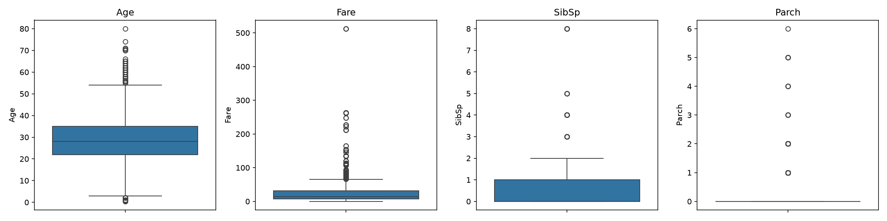
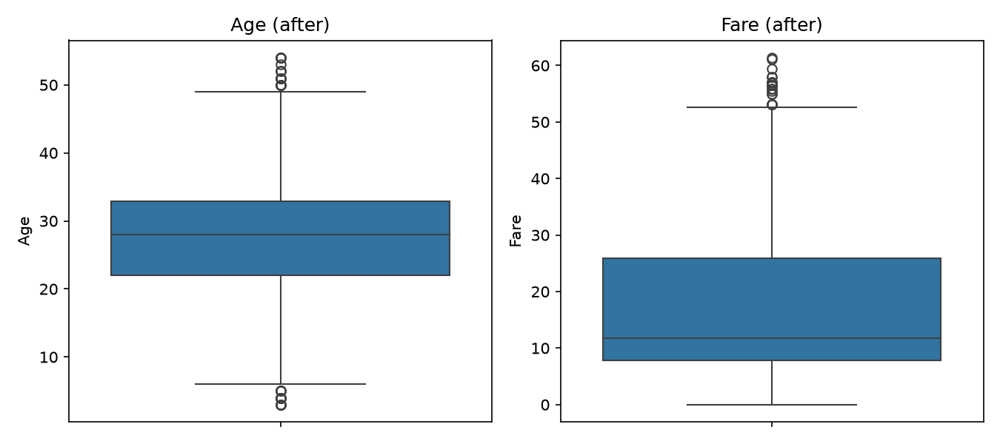

# Task 1: Data Cleaning & Preprocessing (Titanic Dataset)

**Elevate Labs AIML Internship, Task 1**

## Objective
Learn how to clean and prepare raw data for Machine Learning. Raw data is almost never ready for a model, so this task walks through the full cleaning pipeline: exploring the data, handling missing values, encoding categorical features, removing outliers, and scaling numerical features.

## Tools Used
Python 3.11, Pandas, NumPy, Matplotlib, Seaborn, scikit-learn, Jupyter Notebook (in VS Code)

## Dataset
Titanic dataset (`data/Titanic-Dataset.csv`): 891 passengers and 12 columns (survival status, class, name, sex, age, family members aboard, ticket, fare, cabin, port of embarkation).

## Project Structure
```
Elevate-labs-aiml-task-1-data-cleaning/
├── data/
│   ├── Titanic-Dataset.csv                  # raw dataset
│   ├── titanic_cleaned.csv                  # cleaned data (unscaled)
│   └── titanic_cleaned_standardized.csv     # cleaned + standardized data
├── images/
│   ├── boxplots_before.png                  # outliers before removal
│   └── boxplots_after.png                   # after removal
├── task1_data_cleaning.ipynb                # main notebook
├── .gitignore
└── README.md
```

## How to Run
```bash
git clone <this-repo-url>
cd Elevate-labs-aiml-task-1-data-cleaning
python3 -m venv venv
source venv/bin/activate
pip install pandas numpy matplotlib seaborn scikit-learn ipykernel
```
Then open `task1_data_cleaning.ipynb` in VS Code (or Jupyter) and select the `venv` kernel. Run all cells from top to bottom.

---

## Steps Performed (with line-by-line explanation)

### Step 1: Import the dataset and explore basic info

```python
import pandas as pd
import numpy as np
import matplotlib.pyplot as plt
import seaborn as sns

df = pd.read_csv("data/Titanic-Dataset.csv")
print("Shape:", df.shape)
df.head()
```
- `import pandas as pd`: loads Pandas, the main library for working with tables (DataFrames). `pd` is the standard short name.
- `import numpy as np`: loads NumPy for numerical operations. Pandas is built on it.
- `import matplotlib.pyplot as plt`: loads Matplotlib's plotting interface for drawing charts.
- `import seaborn as sns`: loads Seaborn, which makes nicer statistical plots (like boxplots) on top of Matplotlib.
- `df = pd.read_csv("data/Titanic-Dataset.csv")`: reads the CSV file into a DataFrame called `df`. Everything we do next works on `df`.
- `print("Shape:", df.shape)`: prints (rows, columns). This tells us the size of the dataset: 891 rows and 12 columns.
- `df.head()`: shows the first 5 rows so we can see what the columns and values look like.

```python
df.info()
```
- `df.info()`: shows each column's name, how many non-null values it has, and its data type (int, float, object/text). This is where we first spot missing data and see which columns are categorical (object).

```python
print(df.isnull().sum())
print("\nMissing %:")
print((df.isnull().mean() * 100).round(1))
```
- `df.isnull()`: gives a True/False table where True means the value is missing.
- `.sum()`: adds up the True values per column, giving the **count** of missing values in each column.
- `print("\nMissing %:")`: prints a label (`\n` adds a blank line before it).
- `df.isnull().mean() * 100`: the mean of True/False is the fraction missing, and multiplying by 100 gives the **percentage**.
- `.round(1)`: rounds to 1 decimal place for readability.
- **Finding:** `Age`, `Cabin` and `Embarked` have missing values. `Cabin` is about 77% missing.

```python
df.describe()
```
- `df.describe()`: shows count, mean, standard deviation, min, quartiles and max for every numeric column. It helps us spot strange values and differences in scale (for example, `Fare` is much larger than `Parch`).

```python
print(df["Survived"].value_counts())
print(df["Survived"].value_counts(normalize=True).round(2))
```
- `df["Survived"]`: selects the target column (1 = survived, 0 = did not).
- `.value_counts()`: counts how many rows have each value.
- `normalize=True`: returns proportions instead of counts.
- `.round(2)`: rounds to 2 decimals.
- **Finding:** about 62% did not survive and 38% did, so the classes are moderately imbalanced.

---

### Step 2: Handle missing values

```python
df["Age"] = df["Age"].fillna(df["Age"].median())
df["Embarked"] = df["Embarked"].fillna(df["Embarked"].mode()[0])
df = df.drop(columns=["Cabin"])

print(df.isnull().sum())
```
- `df["Age"].median()`: finds the middle value of Age. The median is used instead of the mean because Age is skewed and the median isn't affected by extreme values.
- `df["Age"].fillna(...)`: replaces every missing Age with that median.
- `df["Age"] = ...`: saves the filled column back into the DataFrame.
- `df["Embarked"].mode()`: finds the most frequent value. `Embarked` is categorical (text), so mean and median don't apply, and mode is the right choice.
- `[0]`: `mode()` returns a list-like result (there can be ties), so `[0]` takes the first value.
- `.fillna(...)` and the assignment: fill the 2 missing `Embarked` values with that most common port.
- `df.drop(columns=["Cabin"])`: removes the Cabin column. With roughly 77% missing, filling it would mean inventing most of the data, so dropping is better.
- `df = ...`: saves the DataFrame without the column.
- `print(df.isnull().sum())`: verifies that every column now shows 0 missing values.

---

### Step 3: Drop useless columns and encode categorical features

```python
df = df.drop(columns=["PassengerId", "Name", "Ticket"])

df["Sex"] = df["Sex"].map({"male": 0, "female": 1})
df = pd.get_dummies(df, columns=["Embarked"], drop_first=True, dtype=int)

df.head()
```
- `df.drop(columns=["PassengerId", "Name", "Ticket"])`: removes identifier columns. They're unique per passenger and carry no pattern a model can learn from.
- `df["Sex"].map({"male": 0, "female": 1})`: replaces the text with numbers using the dictionary. `Sex` has only two categories, so a simple 0/1 mapping works.
- `df["Sex"] = ...`: saves the numeric column back.
- `pd.get_dummies(df, columns=["Embarked"], ...)`: performs **one-hot encoding**, creating a separate 0/1 column for each port (C, Q, S). Embarked has no natural order, so one-hot avoids implying that S > Q > C.
- `drop_first=True`: drops the first dummy column (`Embarked_C`). If both `Embarked_Q` and `Embarked_S` are 0, the passenger must be from C, so the extra column is redundant and can cause the "dummy variable trap".
- `dtype=int`: stores the new columns as 0/1 integers instead of True/False.
- `df.head()`: confirms everything is now numeric.

---

### Step 4: Visualize outliers with boxplots

```python
num_cols = ["Age", "Fare", "SibSp", "Parch"]

fig, axes = plt.subplots(1, 4, figsize=(16, 4))
for ax, col in zip(axes, num_cols):
    sns.boxplot(y=df[col], ax=ax)
    ax.set_title(col)
plt.tight_layout()
plt.savefig("images/boxplots_before.png", dpi=150)
plt.show()
```
- `num_cols = [...]`: the list of numeric columns we want to inspect.
- `plt.subplots(1, 4, figsize=(16, 4))`: creates one row of 4 side-by-side plot areas. `fig` is the whole figure, `axes` is the list of 4 areas, and `figsize` sets the size in inches.
- `for ax, col in zip(axes, num_cols):`: loops through plot areas and column names together, pairing the first area with `Age`, the second with `Fare`, and so on.
- `sns.boxplot(y=df[col], ax=ax)`: draws a vertical boxplot of that column in that area. The box shows the middle 50% of values, and dots beyond the whiskers are potential outliers.
- `ax.set_title(col)`: labels each plot with its column name.
- `plt.tight_layout()`: adjusts spacing so titles and labels don't overlap.
- `plt.savefig("images/boxplots_before.png", dpi=150)`: saves the figure as an image for this README (`dpi` controls sharpness).
- `plt.show()`: displays the plot in the notebook.



---

### Step 5: Remove outliers using the IQR method

```python
def remove_outliers_iqr(data, columns):
    for col in columns:
        q1, q3 = data[col].quantile(0.25), data[col].quantile(0.75)
        iqr = q3 - q1
        lower, upper = q1 - 1.5 * iqr, q3 + 1.5 * iqr
        before = len(data)
        data = data[(data[col] >= lower) & (data[col] <= upper)]
        print(f"{col}: removed {before - len(data)} rows")
    return data

df_clean = remove_outliers_iqr(df, ["Age", "Fare"])
print("Rows before:", len(df), "| after:", len(df_clean))
```
- `def remove_outliers_iqr(data, columns):`: defines a reusable function that takes a DataFrame and a list of columns to clean.
- `for col in columns:`: repeats the steps below for each column.
- `data[col].quantile(0.25)`: Q1, the value below which 25% of the data falls.
- `data[col].quantile(0.75)`: Q3, the value below which 75% of the data falls.
- `iqr = q3 - q1`: the Interquartile Range, the spread of the middle 50% of the data.
- `lower = q1 - 1.5 * iqr` and `upper = q3 + 1.5 * iqr`: the standard IQR fences. Anything outside them is treated as an outlier.
- `before = len(data)`: remembers the row count before filtering, so we can report how many rows were removed.
- `data = data[(data[col] >= lower) & (data[col] <= upper)]`: keeps only the rows whose value lies between the fences. `&` means "both conditions must be true".
- `print(f"{col}: removed {before - len(data)} rows")`: reports how many rows this column's filtering removed.
- `return data`: gives the cleaned DataFrame back.
- `df_clean = remove_outliers_iqr(df, ["Age", "Fare"])`: runs the function on `Age` and `Fare` and stores the result in a new DataFrame, so the original `df` stays untouched.
- The function is applied only to `Age` and `Fare`. `SibSp` and `Parch` are small whole-number counts, where IQR would wrongly flag perfectly normal large families as outliers.
- `print("Rows before:", ...)`: shows the total rows lost.

```python
fig, axes = plt.subplots(1, 2, figsize=(9, 4))
for ax, col in zip(axes, ["Age", "Fare"]):
    sns.boxplot(y=df_clean[col], ax=ax)
    ax.set_title(f"{col} (after)")
plt.tight_layout()
plt.savefig("images/boxplots_after.png", dpi=150)
plt.show()
```
- This is the same plotting pattern as Step 4, but on the cleaned data (`df_clean`) and only for `Age` and `Fare`, to confirm the extreme points are gone. The title gets "(after)" via an f-string.



---

### Step 6: Normalize / standardize numerical features

```python
from sklearn.preprocessing import StandardScaler, MinMaxScaler

scale_cols = ["Age", "Fare", "SibSp", "Parch"]

df_std = df_clean.copy()
df_std[scale_cols] = StandardScaler().fit_transform(df_std[scale_cols])

df_norm = df_clean.copy()
df_norm[scale_cols] = MinMaxScaler().fit_transform(df_norm[scale_cols])

print("Standardized:")
print(df_std[scale_cols].describe().loc[["mean", "std"]].round(2))
print("\nNormalized:")
print(df_norm[scale_cols].describe().loc[["min", "max"]].round(2))
```
- `from sklearn.preprocessing import StandardScaler, MinMaxScaler`: imports two scaling tools from scikit-learn.
- `scale_cols = [...]`: the numeric columns to scale. We leave out `Survived`, `Pclass`, `Sex` and the dummy columns because they're labels or categories, not continuous measurements.
- `df_std = df_clean.copy()`: makes an independent copy so scaling doesn't change `df_clean`.
- `StandardScaler()`: creates a scaler that applies **standardization**: `z = (x − mean) / std`. The result has mean 0 and standard deviation 1.
- `.fit_transform(...)`: `fit` learns each column's mean and std, and `transform` applies the formula, all in one call.
- `df_std[scale_cols] = ...`: writes the scaled values back into those columns of the copy.
- `df_norm = df_clean.copy()`: another independent copy for the second method.
- `MinMaxScaler()`: creates a scaler that applies **normalization**: `x' = (x − min) / (max − min)`. All values end up between 0 and 1.
- `df_norm[scale_cols] = ...`: writes the normalized values back.
- `df_std[scale_cols].describe().loc[["mean", "std"]].round(2)`: picks just the mean and std rows from the summary to verify the result is about 0 and 1.
- `df_norm[scale_cols].describe().loc[["min", "max"]].round(2)`: picks the min and max rows to verify the values span 0 to 1.

> **Note:** Here the scalers are fit on the whole dataset for demonstration. In a real ML project, fit the scaler on the training set only and then apply it to the test set, to avoid data leakage.

---

### Step 7: Save the cleaned datasets

```python
df_clean.to_csv("data/titanic_cleaned.csv", index=False)
df_std.to_csv("data/titanic_cleaned_standardized.csv", index=False)
print("Saved!")
```
- `df_clean.to_csv("data/titanic_cleaned.csv", ...)`: writes the cleaned (unscaled) data to a CSV file.
- `index=False`: stops Pandas from adding an extra column with row numbers.
- The second line saves the cleaned and standardized version the same way.
- `print("Saved!")`: confirms the files were written.

---

## Summary of Results

| Stage | Result |
|---|---|
| Raw data | 891 rows × 12 columns |
| Missing values | `Age` filled with the median, `Embarked` with the mode, `Cabin` dropped |
| Dropped columns | `PassengerId`, `Name`, `Ticket`, `Cabin` |
| Encoding | `Sex` mapped to 0/1, `Embarked` one-hot encoded |
| Outliers | Removed from `Age` and `Fare` using the IQR method |
| Scaling | Standardized (mean 0, std 1) and normalized (0 to 1) versions created |
| Final output | Cleaned CSV files saved in `data/` |

## What I Learned
- How to explore a dataset (shape, types, nulls, summary statistics)
- Choosing an imputation method based on the data type and distribution
- The difference between label-style mapping and one-hot encoding
- Detecting outliers visually (boxplots) and statistically (IQR)
- The difference between normalization and standardization

---

## Interview Questions & Answers

### 1. What are the different types of missing data?
There are three types:
- **MCAR (Missing Completely At Random):** the missingness has no relationship with any data. Example: a sensor randomly fails. Dropping or imputing these rows is generally safe.
- **MAR (Missing At Random):** the missingness depends on *other observed* columns, but not on the missing value itself. Example: younger people skip an income question. It can be handled with imputation based on other columns.
- **MNAR (Missing Not At Random):** the missingness depends on the missing value itself. Example: people with very high incomes refuse to report them. This is the hardest case and can bias the model if ignored.

### 2. How do you handle categorical variables?
ML models need numbers, so categories are encoded:
- **Label/ordinal encoding:** assign integers (for ordered categories like Low < Medium < High, or binary ones like male/female).
- **One-hot encoding:** one 0/1 column per category (for unordered categories like city or port).
- **Other methods:** frequency encoding, target encoding, or embeddings for high-cardinality columns.

In this task, `Sex` was mapped to 0/1 and `Embarked` was one-hot encoded.

### 3. What is the difference between normalization and standardization?
- **Normalization (Min-Max scaling):** rescales values to a fixed range, usually 0 to 1, using `(x − min) / (max − min)`. It's sensitive to outliers because they set the min and max.
- **Standardization (Z-score):** rescales values to mean 0 and standard deviation 1 using `(x − mean) / std`. It doesn't bound values to a range and is less affected by outliers.

Use normalization for algorithms that need bounded inputs (neural networks, KNN), and standardization for algorithms that assume roughly Gaussian data (linear/logistic regression, SVM, PCA).

### 4. How do you detect outliers?
- **Visual:** boxplots, scatter plots, histograms.
- **IQR method:** flag values below Q1 − 1.5×IQR or above Q3 + 1.5×IQR (used in this task).
- **Z-score:** flag values more than about 3 standard deviations from the mean.
- **Model-based:** Isolation Forest, DBSCAN, Local Outlier Factor.

After detecting outliers, decide whether to remove, cap (winsorize) or keep them, since some are genuine and informative.

### 5. Why is preprocessing important in ML?
Models learn from the data they're given, so poor data leads to poor models ("garbage in, garbage out"). Preprocessing:
- removes noise, errors and missing values that models can't handle,
- converts data into the numeric format algorithms require,
- puts features on comparable scales so none dominates unfairly,
- reduces bias from outliers and improves training stability and speed.

### 6. What is one-hot encoding vs label encoding?
- **Label encoding** converts each category into one integer (e.g., S=0, C=1, Q=2) in a single column. It's compact, but the model may wrongly read an order or distance between categories, so it suits ordered or binary features.
- **One-hot encoding** creates one binary column per category (e.g., `Embarked_C`, `Embarked_Q`, `Embarked_S`). It implies no order, but adds more columns, which can be a problem when a feature has many categories.

### 7. How do you handle data imbalance?
- **Resampling:** oversample the minority class (e.g., SMOTE, which creates synthetic samples) or undersample the majority class.
- **Class weights:** tell the model to penalize mistakes on the minority class more (`class_weight="balanced"`).
- **Better metrics:** use precision, recall, F1-score and ROC-AUC instead of plain accuracy, which is misleading on imbalanced data.
- **Other options:** stratified train/test splits, ensemble methods built for imbalance, or collecting more minority-class data.

The Titanic target is only moderately imbalanced (about 62% / 38%), so it isn't a major issue here.

### 8. Can preprocessing affect model accuracy?
Yes, often a lot. Good preprocessing (sensible imputation, proper encoding, scaling, outlier handling) usually improves accuracy and stability, and lets distance-based and gradient-based models train properly. Poor preprocessing can hurt: removing too many rows loses information, wrong imputation adds bias, and fitting scalers on the full dataset before splitting causes **data leakage**, giving falsely high accuracy. Preprocessing choices should be tested and validated, not applied blindly.

---

## Author
**Uzair Riyaz** | [GitHub](https://github.com/uzair1355) | [LinkedIn](https://linkedin.com/in/mohammad--uzair)